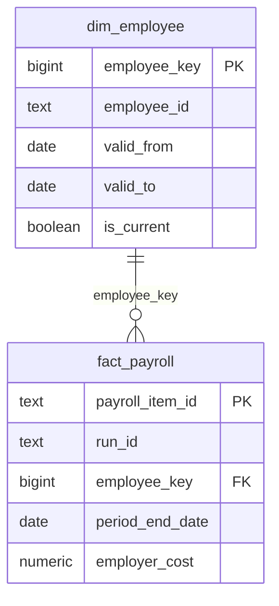
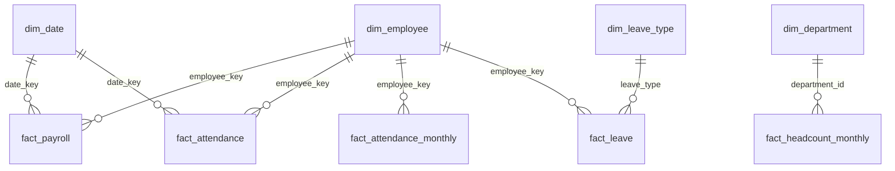

# PulseIQ Analytics Warehouse

## Database

- Database: `pulseiq_wh`
- Schema: `dw`
- Platform: PostgreSQL

## Table grain

- `dw.dim_employee`: One row per employee version, identified by `employee_key` and `valid_from`.
- `dw.fact_payroll`: One row per payroll item, identified by `payroll_item_id`.
- `dw.dim_department`: One row per department.
- `dw.dim_role`: One row per role.
- `dw.dim_leave_type`: One row per leave type.
- `dw.dim_date`: One row per calendar date.
- `dw.fact_attendance_monthly`: One row per employee per month.
- `dw.fact_leave`: One row per leave request.
- `dw.fact_headcount_monthly`: One row per department per month.
- `dw.fact_attendance`: One row per employee per day.

## Relationships

## Idempotent loading

The loader uses PostgreSQL `ON CONFLICT` upserts. Re-running it updates existing records rather than inserting duplicates.

## Validation results

- `PR-2025-04` employer cost: `53363392.08`
- `PR-2026-09` employees paid: `444`

## Employee history validation

Employee history is loaded with SCD Type 2 versions from `employee_assignments`.

Test employee: `EMP-0002`

- Before 2023-07-18: department `D01`
- From 2023-07-18: department `D08`
- Seven historical versions are present in `dw.dim_employee`.
- Historical versions have `is_current = false`; the latest version has `is_current = true`.

## Indexes

- `idx_employee_id` on `dw.dim_employee(employee_id)`
- `idx_employee_valid_dates` on `dw.dim_employee(valid_from, valid_to)`
- `idx_payroll_run` on `dw.fact_payroll(run_id)`
- `idx_payroll_employee` on `dw.fact_payroll(employee_key)`
- `idx_payroll_period` on `dw.fact_payroll(period_end_date)`
- `idx_payroll_date_key` on `dw.fact_payroll(date_key)`

## Headcount validation

Reference comparison for department D01, April 2025:
- Headcount end: 142
- Hires: 2
- Exits: 3
- Monthly attrition rate: 2.1%

The warehouse headcount values match `reference_summary_dept_month`.

## Leadership questions

1. What is the payroll cost by department and month?
2. How does headcount change over time?
3. What is attendance by month?
4. What is the monthly attrition rate by department?
5. How many leave requests are recorded by leave type?

## Schema diagram

## Daily attendance grain

`dw.fact_attendance`: One row per employee per day, identified by `attendance_id`.

## Validation

All three SQL checks match the provided reference values:
- Payroll employer cost for `PR-2025-04`: `53363392.08`
- Employees paid in `PR-2026-09`: `444`
- Department D01 headcount for April 2025: `142`, hires: `2`, exits: `3`, attrition: `2.1%`
